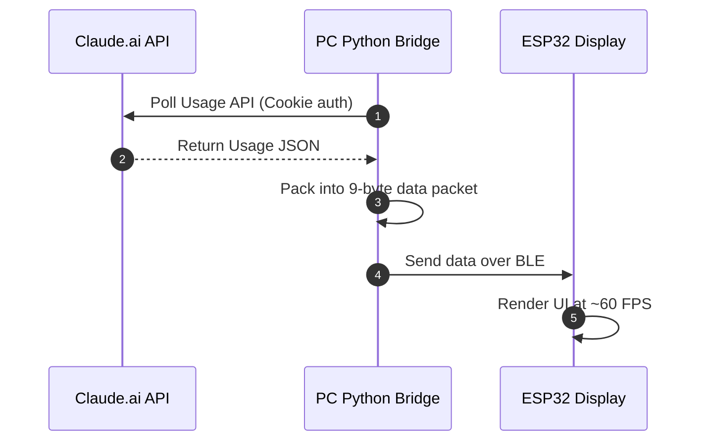

# ClaudeMeter

**English** | [中文](README.zh-TW.md)

<p align="center">
  
  
  
  
  
  
</p>

<p align="center">
  <b>A desktop hardware monitor that displays your Claude AI usage and rate limits in real-time over Bluetooth Low Energy.</b><br>
  Built on an ESP32-S + 2.2" TFT display, paired with a PC-side BLE bridge.
</p>

---

## Preview

<p align="center">
  
  
</p>

---

## Why I Built This

Claude is a tool I genuinely find useful, but token consumption burns through fast — especially getting cut off mid-conversation when the quota runs out, which gives me a kind of "token anxiety." I'm still a student, so I don't interact with Claude as intensively as a full-time developer would all day, but being able to check my current usage at a glance helps me plan out my day — knowing how much of my 5-hour quota is left tells me how to sequence tasks and how hard I can push.

I looked around on GitHub and found quite a few third-party extensions people had built for their own computers, which told me this wasn't just my own problem. But I personally prefer looking at a physical screen — it feels more tangible to me than a software overlay — so I didn't consider just using one of those.

After some basic research I found there are already well-integrated projects out there (like HermannBjorgvin's), but they weren't easy for me to get hold of, and would likely have cost extra. So I decided to design a token-usage display using parts I already had on hand — parts that are also common and easy to source — and this project is the result.

The enclosure is on the "later, when I have time" list. I don't have much time to design one right now, so I finished the core functionality first and shelved the enclosure for the time being.

---

## Real Development Problems & How I Handled Them

### Switching from Arduino IDE to PlatformIO

The firmware started as an Arduino IDE sketch, but quickly hit a well-known pain point in the `TFT_eSPI` library: screen configuration has to be edited directly inside the library's own `User_Setup.h`. That's not friendly for anyone cloning the repo — they'd have to hunt down their Arduino libraries folder and edit someone else's source file, and if another project on the same machine also uses `TFT_eSPI`, the two configs would clobber each other. I later moved the firmware build to PlatformIO instead, injecting the panel driver and pin configuration through `build_flags` at compile time, so nothing outside the repo needs to be touched, the configuration is version-controlled with everything else, and it's easier to use and maintain.

### Known Issue: macOS Version

The macOS bridge script doesn't actually run right now. It was written against a `bleak.BleakServer` class that, on closer inspection of the `bleak` source, doesn't exist in any released version — the library has only ever supported the BLE client/scanner role, never a GATT server (peripheral) mode. A working GATT server on macOS means talking to CoreBluetooth's peripheral manager directly through `pyobjc`, a meaningfully bigger piece of work. The gap is marked in the code with a `# type: ignore` so CI doesn't fail on it, and the script is flagged as experimental/non-functional in this README.

---

## Technical Scope

The project spans several layers: C++ firmware on the ESP32 handles display rendering and the BLE GATT server; a Python bridge polls Claude.ai's private API on a timer and packs the response into a custom 9-byte binary protocol sent over BLE; and `ruff`/`black`/`mypy` plus a GitHub Actions CI pipeline handle basic code-quality checks.

---

## Bill of Materials

- **ESP32-S dev board** (ESP32-WROOM-32) x 1
- **2.2" TFT SPI LCD display** (320x240, ILI9341 driver) x 1
- **Jumper wires / breadboard** (at least 8 jumper wires)

---

## Pinout Table

| ESP32-S Pin | TFT Display Pin | Description |
| :--- | :--- | :--- |
| **GPIO 21** | **BLK / LED** | Backlight control (PWM brightness) |
| **GPIO 18** | **SCK / SCL** | SPI clock |
| **GPIO 23** | **SDA / MOSI**| SPI data |
| **GPIO 5**  | **CS**         | SPI chip select |
| **GPIO 16** | **DC / RS**    | Data/command switch |
| **GPIO 17** | **RST / RES**  | Display hardware reset |
| **3.3V**    | **VCC**        | Power (3.3V) |
| **GND**     | **GND**        | Ground |

---

## How It Works



1. The PC-side Python script polls the [Claude.ai](https://claude.ai) API every 60 seconds by default, using a logged-in session cookie (the interval is configurable via `POLL_INTERVAL_SECONDS` in `.env`).
2. The script packs the Session (5-hour) and Weekly (7-day) usage percentages, their reset countdowns, and the screen backlight brightness into a lightweight **9-byte** packet.
3. The packet is sent to the ESP32 over Bluetooth Low Energy (BLE); the ESP32 updates its UI cards and gradient progress bars in real time.

---

## Setup Guide

### Step 1: Flash the ESP32 Firmware (`esp32_firmware/`)

The firmware is built with **PlatformIO** (source at `esp32_firmware/src/main.cpp`). Unlike Arduino IDE, PlatformIO doesn't require manually editing `TFT_eSPI`'s `User_Setup.h` — the display driver and pin configuration are already defined in `esp32_firmware/platformio.ini`'s `build_flags`, version-controlled alongside the rest of the repo, and won't clash with other projects on your machine that also use `TFT_eSPI`.

1. Install [PlatformIO](https://platformio.org/install/cli):
   - **VSCode users**: install the PlatformIO IDE extension, then open the `esp32_firmware/` folder in VSCode.
   - **CLI users**: `pip install platformio`.
2. Connect the ESP32 board to your computer via USB.
3. Flash the firmware:
   - VSCode: click the PlatformIO icon in the sidebar → **Upload**.
   - CLI:
     ```bash
     cd esp32_firmware
     pio run --target upload
     ```
4. If your wiring or display driver differs from the default, just edit the `build_flags` in `esp32_firmware/platformio.ini` (matching the pinout table above) — no need to touch the `TFT_eSPI` library itself.

> `esp32_firmware/ClaudeMeter/ClaudeMeter.ino` is the old Arduino IDE project and is deprecated — use the PlatformIO flow above instead.

---

### Step 2: Set Up the PC-side Python Environment (`pc_bridge/`)

1. **Copy the config template**:
   ```bash
   cp .env.example .env
   ```

2. **Fill in your credentials**:
   Log into [Claude.ai](https://claude.ai) in your browser, open DevTools with `F12` (Network tab):
   - Copy the `Cookie` string into `CLAUDE_COOKIE='...'` in `.env` (single quotes recommended).
   - Copy your `Organization ID` into `CLAUDE_ORG_ID="..."` in `.env`.

3. **Install Python dependencies**:
   ```bash
   python -m venv venv
   
   # Activate on Windows:
   .\venv\Scripts\activate
   
   # Activate on macOS:
   source venv/bin/activate
   
   pip install -r requirements.txt
   ```

   > `requirements.txt` is all you need to run the bridge scripts. If you also want to run lint / formatting / type-checking (e.g. to contribute code), additionally install `pip install -r requirements-dev.txt`.

---

## Usage

### Windows (fully tested)

Make sure Bluetooth is enabled on your computer, then run:

```bash
python pc_bridge/ble_bridge_win.py
```

---

### macOS (untested / experimental)

> **Note**: the macOS script is currently **experimental / untested**. Due to CoreBluetooth's permission model, it runs in BLE GATT Server mode.

```bash
python pc_bridge/ble_bridge_MacOS.py
```

---

## BLE Data Protocol

| Byte Index | Meaning | Type | Example |
| :--- | :--- | :--- | :--- |
| `Byte 0` | 5-Hour Session usage (%) | `uint8_t` (0–100) | `45` (45%) |
| `Byte 1` | 5-Hour reset hour | `uint8_t` (0–23) | `18` |
| `Byte 2` | 5-Hour reset minute | `uint8_t` (0–59) | `30` |
| `Byte 3` | 7-Day Weekly usage (%) | `uint8_t` (0–100) | `12` (12%) |
| `Byte 4` | 7-Day reset month | `uint8_t` (1–12) | `8` |
| `Byte 5` | 7-Day reset day | `uint8_t` (1–31) | `10` |
| `Byte 6` | 7-Day reset hour | `uint8_t` (0–23) | `14` |
| `Byte 7` | 7-Day reset minute | `uint8_t` (0–59) | `0` |
| `Byte 8` | Screen backlight brightness (optional) | `uint8_t` (0–255) | `200` |

> `Byte 8` is optional: the firmware's `onWrite` handler only applies brightness when it receives ≥9 bytes. Older 8-byte packets still work fine, they just won't adjust the backlight. Configure the brightness sent via `BRIGHTNESS` in `.env`.

---

## Troubleshooting

<details>
<summary><b>1. Can't find the ESP32 device?</b></summary>
Make sure the ESP32 is flashed correctly, powered on, and Bluetooth is enabled on your computer.
</details>

<details>
<summary><b>2. HTTP 401 / 403 error?</b></summary>
Your cookie has probably expired. Log into Claude.ai again and update <code>CLAUDE_COOKIE</code> in <code>.env</code>.
</details>

<details>
<summary><b>3. Blank or garbled display?</b></summary>
Check your SPI wiring, and confirm the driver/pin settings in <code>esp32_firmware/platformio.ini</code>'s <code>build_flags</code> (<code>ILI9341_DRIVER</code>, <code>TFT_MOSI</code>/<code>TFT_SCLK</code>/<code>TFT_CS</code>/<code>TFT_DC</code>/<code>TFT_RST</code>, etc.) match your actual wiring.
</details>

---

## Development

The configuration loading, time parsing, and Usage API fetching logic shared by the Windows and macOS bridge scripts lives in `pc_bridge/common.py`. To modify or contribute code, install the dev dependencies and run these checks first:

```bash
pip install -r requirements.txt -r requirements-dev.txt

ruff check pc_bridge      # lint
black --check pc_bridge   # format check (drop --check to auto-format)
mypy pc_bridge             # type-check
```

GitHub Actions (`.github/workflows/ci.yml`) runs these three checks automatically on every push/PR to `main`.

---

## Acknowledgements & Inspiration

The UI concept for this project is inspired by:
- **[HermannBjorgvin/Clawdmeter](https://github.com/HermannBjorgvin/Clawdmeter)** — the original physical Claude usage dashboard project.

This project adapts and rebuilds that idea around more common, affordable parts (ESP32-S + 2.2" SPI TFT display), as a small contribution back to the open-source community.

---

## License

This project is released under the [MIT License](LICENSE).
