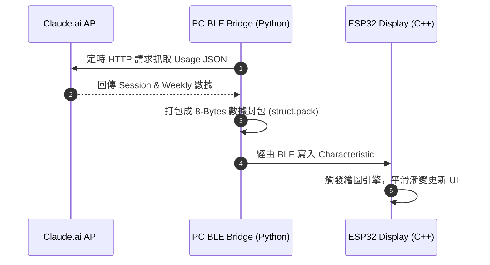

# 🤖 ClaudeMeter

<p align="center">
  
  
  
  
  
</p>

<p align="center">
  <b>一個基於 ESP32 TFT LCD 螢幕與電腦端 BLE Bridge 的即時 Claude AI 額度儀表板</b><br>
  <i>Real-time Claude AI Session & Weekly Usage Monitor over Bluetooth Low Energy</i>
</p>

---

## 📷 展示 (Preview)

> [!TIP]
> 💡 **圖片補充說明**：您可以在此放置您的 ESP32 實體照片或動態展示 GIF。

| 🖥️ 實體儀表板展示 | 📊 雙層額度卡片與動態動畫 |
| :---: | :---: |
| *(請補充您的 ESP32 螢幕照片 `docs/images/device_preview.jpg`)* | *(請補充動畫展示 `docs/images/ui_demo.gif`)* |

---

## 🚀 專案亮點 (Key Features)

- 🎨 **精緻流暢 UI/UX 設計**：採用 320x240 ST7789/ILI9341 TFT 雙緩衝繪製，支援 60 FPS 平滑數值漸變 (Lerp Animation)。
- 👾 **動態點陣吉祥物與星芒**：內建自訂像素風格 Claude 吉祥物（帶 Y 軸懸浮動態）與 360 度旋轉星芒動態渲染。
- ⏱️ **雙重額度即時追蹤**：同時顯示 **5-Hour Session** 與 **7-Day Weekly** 額度百分比及精準重置倒數時間。
- 📡 **無感低功耗 BLE 傳輸**：電腦端定時（每 60 秒）抓取 API 並自動發送 8-byte 二進位極簡封包至 ESP32。
- 🔒 **環境變數安全防護**：認證憑證與 Session Cookie 完全自程式碼分離，透過 `.env` 機制管理。

---

## 📐 系統架構 (Architecture)



---

## 🛠️ 硬體與腳位設定 (Hardware & Pinout)

### 1. 硬體需求
- **ESP32 開發板** (如 ESP32-WROOM-32 或 ESP32-S3)
- **2.4" / 2.8" TFT SPI LCD 螢幕** (解析度 320x240，控制晶片支援 ST7789 / ILI9341)

### 2. 接線參考 (TFT SPI 接線)

| ESP32 腳位 | TFT LCD 螢幕腳位 | 說明 |
| :--- | :--- | :--- |
| **GPIO 21** | **BLK / LED** | 背光 PWM 控制 |
| **GPIO 18** | **SCK / SCL** | SPI 時脈線 |
| **GPIO 23** | **SDA / MOSI**| SPI 數據線 |
| **GPIO 5**  | **CS**         | SPI 晶片選擇 |
| **GPIO 16** | **DC / RS**    | 數據/指令切換 |
| **GPIO 17** | **RST / RES**  | 螢幕硬體重置 |
| **3.3V**    | **VCC**        | 電源 positive |
| **GND**     | **GND**        | 電源 接地 |

> [!NOTE]
> 請確保在 Arduino IDE 的 `TFT_eSPI` 函式庫中，將 `User_Setup.h` 配置為對應的螢幕驅動晶片與上述 GPIO 腳位。

---

## 💻 軟體安裝與設定 (Setup Guide)

### 1. ESP32 韌體燒錄 (`esp32_firmware/`)

1. 下載並安裝 [Arduino IDE](https://www.arduino.cc/en/software)。
2. 安裝 ESP32 開發板支援 (板子管理員搜尋 `esp32` 並安裝)。
3. 安裝必要庫：
   - **TFT_eSPI** (Bodmer)
4. 開啟 `esp32_firmware/ClaudeMeter.ino`。
5. 選擇正確的 ESP32 開發板型號與 COM 埠，點擊 **Upload (燒錄)**。

---

### 2. 電腦端轉接腳本設定 (`pc_bridge/`)

#### A. 複製認證設定檔
複製專案根目錄下的 `.env.example` 並重命名為 `.env`：

```bash
cp .env.example .env
```

#### B. 取得 Claude.ai Session Cookie 與 Organization ID

1. 開啟瀏覽器並登入 [Claude.ai](https://claude.ai)。
2. 按 `F12` 打開開發者工具，切換至 **Network (網路)** 標籤頁。
3. 在 Claude 頁面發送任意訊息或重新整理頁面。
4. 找到 `usage` 或任意 API 請求：
   - 從 **Request Headers** 中複製完整的 `Cookie` 字串，填入 `.env` 中的 `CLAUDE_COOKIE`。
   - 從請求 URL (例如 `https://claude.ai/api/organizations/<ORG_ID>/usage`) 中複製 `ORG_ID`，填入 `.env` 中的 `CLAUDE_ORG_ID`。

範例 `.env` 內容：
```env
CLAUDE_COOKIE="sessionKey=sk-ant-sid02-...; _cfuvid=...;"
CLAUDE_ORG_ID="your_organization_id_here"
```

#### C. 安裝 Python 依賴

建議使用 Python 3.10+ 及虛擬環境：

```bash
# 建立虛擬環境
python -m venv venv

# 啟動虛擬環境 (Windows)
.\venv\Scripts\activate

# 啟動虛擬環境 (macOS/Linux)
source venv/bin/activate

# 安裝套件
pip install -r requirements.txt
```

---

## 🏃 執行方式 (Usage)

### 🖥️ Windows (推薦/已完整實測)

```bash
python pc_bridge/ble_bridge_win.py
```
> **運作機制**：Windows 腳本將作為 BLE Client，自動搜尋名為 `ClaudeMeter` 的 ESP32 裝置並將資料寫入。

---

### 🍎 macOS 

> [!WARNING]
> ⚠️ **注意：macOS 版本目前為實驗性/未測試版本 (Experimental / Untested)**。
> 由於 CoreBluetooth 系統權限與限制，macOS 腳本作為 BLE GATT Server 運行，供 ESP32 連線讀取。若您在 macOS 上進行了測試與改進，非常歡迎提交 PR 協助改進！

```bash
python pc_bridge/ble_bridge_MacOS.py
```

---

## 📦 BLE 數據通訊協定 (Packet Protocol)

電腦端透過 BLE 發送 **8-Byte 二進位純數據封包** 給 ESP32：

| Byte 索引 | 資料意義 | 資料型別 | 範例值 |
| :--- | :--- | :--- | :--- |
| `Byte 0` | 5-Hour Session 額度使用率 (%) | `uint8_t` (0~100) | `45` (代表 45%) |
| `Byte 1` | 5-Hour 重置小時 (Hour) | `uint8_t` (0~23) | `18` (代表 18:xx) |
| `Byte 2` | 5-Hour 重置分鐘 (Minute) | `uint8_t` (0~59) | `30` (代表 xx:30) |
| `Byte 3` | 7-Day Weekly 額度使用率 (%) | `uint8_t` (0~100) | `12` (代表 12%) |
| `Byte 4` | 7-Day 重置月份 (Month) | `uint8_t` (1~12) | `8` (代表 8 月) |
| `Byte 5` | 7-Day 重置日期 (Day) | `uint8_t` (1~31) | `10` (代表 10 日) |
| `Byte 6` | 7-Day 重置小時 (Hour) | `uint8_t` (0~23) | `14` |
| `Byte 7` | 7-Day 重置分鐘 (Minute) | `uint8_t` (0~59) | `0` |

---

## ❓ 疑難排解 (Troubleshooting & FAQ)

<details>
<summary><b>1. 電腦端提示未找到 ESP32 裝置？</b></summary>
<ul>
  <li>請確認 ESP32 已正常通電且螢幕運作中。</li>
  <li>確認電腦藍芽已開啟。</li>
  <li>確認 ESP32 程式碼中的 <code>DEVICE_NAME</code> 為 "ClaudeMeter"。</li>
</ul>
</details>

<details>
<summary><b>2. 出現 HTTP 401 或 HTTP 403 錯誤？</b></summary>
<ul>
  <li>您的 Claude Session Cookie 可能已過期。請重新開啟瀏覽器登入 Claude.ai 並更新 <code>.env</code> 中的 <code>CLAUDE_COOKIE</code>。</li>
</ul>
</details>

<details>
<summary><b>3. ESP32 螢幕白屏或顯示異常？</b></summary>
<ul>
  <li>請檢查 SPI 接線是否牢固。</li>
  <li>檢查 <code>TFT_eSPI</code> 的 <code>User_Setup.h</code> 設定是否對應您採用的螢幕驅動（ST7789 / ILI9341）與正確腳位。</li>
</ul>
</details>

---

## 📄 授權條款 (License)

本專案採用 [MIT License](LICENSE) 條款開源發行。歡迎自由分支與修飾！
