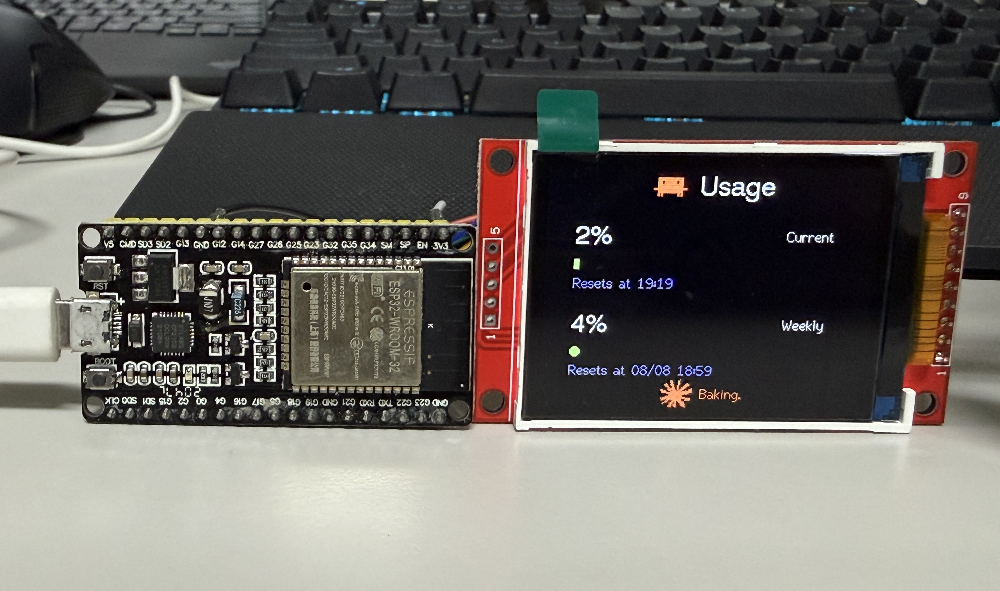
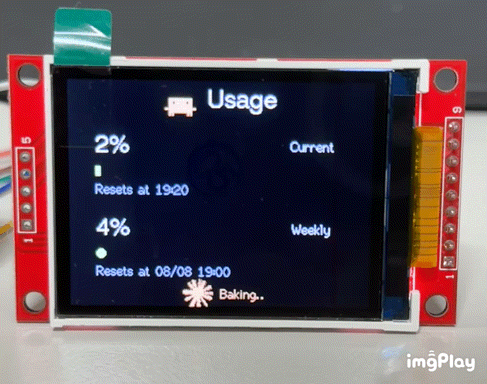
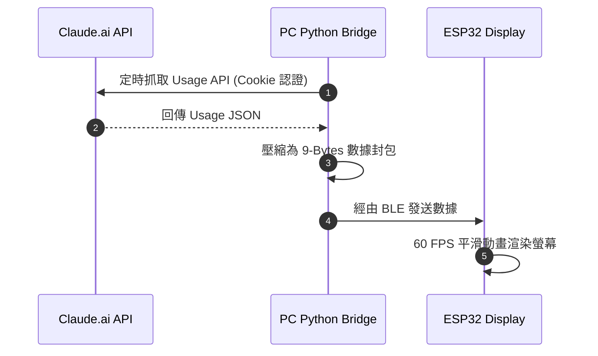

# ClaudeMeter

[English](README.md) | **中文**

<p align="center">
  
  
  
  
  
  
</p>

<p align="center">
  <b>基於 ESP32-S + 2.2" TFT 螢幕與電腦端 BLE Bridge 的即時 Claude AI 額度儀表板</b>
</p>

---

## 展示

<p align="center">
  
  
</p>

---

## 動機

Claude 是我覺得很好用的工具，但缺點是 token 消耗速度很快，尤其討論到一半突然被告知額度用完，會有一種「token 焦慮」。雖然我目前還是學生，不像全職開發者需要整天密集跟 Claude 互動，但如果能隨時知道目前的用量，就能幫我調整一整天的任務順序——透過剩餘的 5 小時額度，決定接下來的任務該怎麼排、工作強度該拉多高。

我在 GitHub 上找過，發現有不少人做了裝在電腦上的第三方插件，代表這個痛點是真實存在的，不只我一個人有感覺。但我自己比較偏好看實體螢幕，對我來說比軟體介面更有連結感，所以沒有考慮直接用那些插件。

稍微調查之後發現，市面上已經有整合度很高的成品專案（例如 HermannBjorgvin 的作品），但對我來說不容易取得，而且可能要負擔額外的費用。所以我決定用手邊就有、也算常見易取得的材料，自己規劃一組能顯示 token 用量的顯示器，最後的成果就是這個專案。

外殼的部分列為之後有空再做的項目。目前沒有太多時間畫外殼設計，所以先把核心功能做完、公開出來，外殼暫時擱置。

---

## 實際開發問題與處理方式

### 從 Arduino IDE 換成 PlatformIO

韌體最初用 Arduino IDE 開發，很快就撞上 `TFT_eSPI` 函式庫的老問題：螢幕設定得直接改函式庫資料夾裡的 `User_Setup.h`。但這對於每個 clone 這個 repo 的人而言並不友善，需要手動找到 Arduino 函式庫路徑、去改別人的原始碼，電腦上若還有其他專案也用同一顆函式庫，設定也會互相覆蓋。因此後期將韌體建置流程換成 PlatformIO，螢幕腳位與驅動晶片改用 `build_flags` 在編譯期注入，不需要碰函式庫本身，設定也隨 repo 一起進行版控，更易於使用及維護。

### macOS 版本的已知問題

macOS 版本的 bridge 目前其實跑不起來。當初寫的時候用了 `bleak.BleakServer` 這個 class，後來實際去查 `bleak` 套件原始碼才發現，它從頭到尾都只支援 BLE Client/Scanner，沒有內建 GATT Server（Peripheral）模式——要在 macOS 上做出真正能跑的 GATT Server，得直接串 `pyobjc` 去接 CoreBluetooth 的 Peripheral Manager，是完全不同量級的工程。目前在程式碼裡用 `# type: ignore` 註記這個已知問題，讓 CI 不會因此失敗，並在這份 README 裡標註「實驗性/已知無法運作」。

---

## 技術涵蓋範圍

整個專案跨了好幾層：ESP32 韌體用 C++ 處理畫面渲染與 BLE GATT Server；PC 端用 Python 定時讀取 Claude.ai 私有 API，封裝成自訂的 9-byte 二進位協定透過 BLE 傳輸；另外搭配 `ruff`/`black`/`mypy` 與 GitHub Actions CI 做基本的程式碼品質把關。

---

## 硬體需求與材料清單

- **ESP32-S 開發板** (ESP32-WROOM-32) x 1
- **2.2" TFT SPI LCD 顯示螢幕** (解析度 320x240，驅動晶片為 ILI9341) x 1
- **杜邦線 / 面包板** 若干條 (最少需要8條杜邦線)

---

## 螢幕接線指南

| ESP32-S 腳位 | TFT 螢幕腳位 | 說明 |
| :--- | :--- | :--- |
| **GPIO 21** | **BLK / LED** | 背光控制 (PWM 亮度) |
| **GPIO 18** | **SCK / SCL** | SPI 時脈線 |
| **GPIO 23** | **SDA / MOSI**| SPI 數據線 |
| **GPIO 5**  | **CS**         | SPI 晶片選擇 |
| **GPIO 16** | **DC / RS**    | 數據/指令切換 |
| **GPIO 17** | **RST / RES**  | 螢幕硬體重置 |
| **3.3V**    | **VCC**        | 電源 (3.3V) |
| **GND**     | **GND**        | 接地 |

---

## 運作原理



1. 電腦端 Python 腳本預設每 60 秒透過已登入的 Cookie 抓取 [Claude.ai](https://claude.ai) API(間隔秒數可在 `.env` 的 `POLL_INTERVAL_SECONDS` 調整)。
2. 腳本將 Session (5-Hour) 與 Weekly (7-Day) 的額度百分比、倒數重置時間，以及螢幕背光亮度，打包為 **9 個 Byte** 的輕量封包。
3. 透過低功耗藍芽 (BLE) 無感發送給 ESP32，ESP32 收到後即時更新流暢的 UI 視覺卡片與漸變進度條。

---

## 安裝步驟

### 步驟 1：燒錄 ESP32 韌體 (`esp32_firmware/`)

本專案韌體改用 **PlatformIO** 建置(原始碼在 `esp32_firmware/src/main.cpp`)。相較 Arduino IDE，PlatformIO 不需要手動修改 `TFT_eSPI` 函式庫內的 `User_Setup.h` ——螢幕驅動晶片與腳位設定已經寫在 `esp32_firmware/platformio.ini` 的 `build_flags` 裡，隨 repo 一起版本控制，不會跟你電腦上其他也用到 `TFT_eSPI` 的專案互相覆蓋。

1. 安裝 [PlatformIO](https://platformio.org/install/cli)：
   - **VSCode 使用者**：安裝 PlatformIO IDE 擴充套件，安裝完成後用 VSCode 開啟 `esp32_firmware/` 資料夾。
   - **命令列使用者**：`pip install platformio`。
2. 用 USB 連接 ESP32 開發板到電腦。
3. 燒錄韌體：
   - VSCode：點擊左側 PlatformIO 圖示 → **Upload**。
   - 命令列：
     ```bash
     cd esp32_firmware
     pio run --target upload
     ```
4. 若螢幕接線或驅動晶片跟預設不同，直接編輯 `esp32_firmware/platformio.ini` 裡的 `build_flags`（對照上面的接線表調整）即可，不需要碰 `TFT_eSPI` 函式庫本身的檔案。

> `esp32_firmware/ClaudeMeter/ClaudeMeter.ino` 是舊版 Arduino IDE 專案，已停用，請改用上述 PlatformIO 流程。

---

### 步驟 2：設定電腦端 Python 環境 (`pc_bridge/`)

1. **複製設定檔範本**：
   ```bash
   cp .env.example .env
   ```

2. **填入認證資訊**：
   開啟瀏覽器登入 [Claude.ai](https://claude.ai)，按 `F12` 打開開發者工具 (Network 標籤頁)：
   - 複製 `Cookie` 字串，填入 `.env` 中的 `CLAUDE_COOKIE='...'` (建議使用單引號包裹)。
   - 複製 `Organization ID`，填入 `.env` 中的 `CLAUDE_ORG_ID="..."`。

3. **安裝 Python 套件**：
   ```bash
   python -m venv venv
   
   # Windows 啟動虛擬環境:
   .\venv\Scripts\activate
   
   # macOS 啟動虛擬環境:
   source venv/bin/activate
   
   pip install -r requirements.txt
   ```

   > 只是要執行 bridge 腳本的話，裝 `requirements.txt` 就夠了。若想額外跑 lint / 格式化 / 型別檢查（例如要貢獻程式碼），再另外安裝 `pip install -r requirements-dev.txt`。

---

## 啟動執行

### Windows (完整測試通過)

確定電腦藍芽已開啟，並執行：

```bash
python pc_bridge/ble_bridge_win.py
```

---

### macOS (未測試 / Experimental)

> **注意**：macOS 腳本目前為**實驗性/未測試版本 (Experimental / Untested)**。由於 CoreBluetooth 權限機制，macOS 腳本以 BLE GATT Server 模式運行。

```bash
python pc_bridge/ble_bridge_MacOS.py
```

---

## BLE 數據通訊格式

| Byte 索引 | 數據意義 | 型別 | 範例 |
| :--- | :--- | :--- | :--- |
| `Byte 0` | 5-Hour Session 額度使用率 (%) | `uint8_t` (0~100) | `45` (45%) |
| `Byte 1` | 5-Hour 重置小時 (Hour) | `uint8_t` (0~23) | `18` |
| `Byte 2` | 5-Hour 重置分鐘 (Minute) | `uint8_t` (0~59) | `30` |
| `Byte 3` | 7-Day Weekly 額度使用率 (%) | `uint8_t` (0~100) | `12` (12%) |
| `Byte 4` | 7-Day 重置月份 (Month) | `uint8_t` (1~12) | `8` |
| `Byte 5` | 7-Day 重置日期 (Day) | `uint8_t` (1~31) | `10` |
| `Byte 6` | 7-Day 重置小時 (Hour) | `uint8_t` (0~23) | `14` |
| `Byte 7` | 7-Day 重置分鐘 (Minute) | `uint8_t` (0~59) | `0` |
| `Byte 8` | 螢幕背光亮度 (Brightness，可選) | `uint8_t` (0~255) | `200` |

> `Byte 8` 為可選欄位：韌體 `onWrite` 只在收到 ≥9 bytes 時才會套用亮度，收到 8 bytes（舊版封包）也能正常運作，只是不會調整背光。可在 `.env` 用 `BRIGHTNESS` 調整送出的亮度值。

---

## 疑難排解

<details>
<summary><b>1. 找不到 ESP32 裝置？</b></summary>
請確認 ESP32 已正確燒錄並通電，且電腦藍芽已開啟。
</details>

<details>
<summary><b>2. HTTP 401 / 403 錯誤？</b></summary>
Cookie 可能已過期，請重新登入 Claude.ai 並更新 <code>.env</code> 中的 <code>CLAUDE_COOKIE</code>。
</details>

<details>
<summary><b>3. 螢幕白屏或顯示錯亂？</b></summary>
請檢查 SPI 接線是否正確，並確認 <code>esp32_firmware/platformio.ini</code> 裡 <code>build_flags</code> 的驅動晶片與腳位設定（<code>ILI9341_DRIVER</code>、<code>TFT_MOSI</code>/<code>TFT_SCLK</code>/<code>TFT_CS</code>/<code>TFT_DC</code>/<code>TFT_RST</code> 等）是否與實際接線相符。
</details>

---

## 給開發者

`pc_bridge/` 底下 win / macOS 兩支腳本共用的設定讀取、時間解析、Usage API 抓取邏輯都集中在 `pc_bridge/common.py`。若要修改或貢獻程式碼，建議先安裝開發依賴並跑過以下檢查：

```bash
pip install -r requirements.txt -r requirements-dev.txt

ruff check pc_bridge      # lint
black --check pc_bridge   # 格式檢查（要自動排版就把 --check 拿掉）
mypy pc_bridge             # 型別檢查
```

專案設有 GitHub Actions（`.github/workflows/ci.yml`），push / PR 到 `main` 時會自動跑上述三項檢查。

---

## 致謝與參考專案

本專案之 UI 概念與靈感源自：
- **[HermannBjorgvin/Clawdmeter](https://github.com/HermannBjorgvin/Clawdmeter)** - 原創的 Claude Usage 實體儀表板專案。

本專案將該構想適配並重構至更常見、便宜的平價模組（ESP32-S + 2.2" SPI TFT 螢幕），為開源社群貢獻一份心力！

---

## 授權條款

本專案採用 [MIT License](LICENSE) 條款開源發行。
